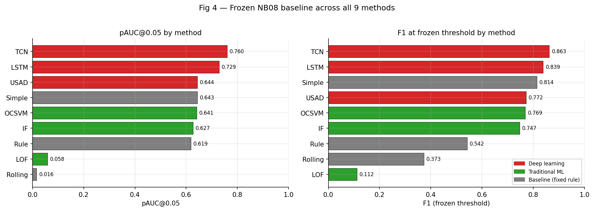

# SWaT Industrial Anomaly Detection

An experimental study of anomaly detection on multivariate telemetry from the Secure Water Treatment (SWaT) testbed. The project compares nine detection methods, evaluates false alarms and event detection, selects a model from recorded evidence, and deploys a working historical-replay monitoring prototype to demonstrate the selected model end to end.

> **Project status:** Notebooks 01–13 are complete. The historical-replay monitoring prototype is **built and deployed on Render** — FastAPI backend, React/Vite frontend, and 4.65 MB of per-partition parquet files committed to the repository under CC0. Full replay, batch advance, live alerts, feature attribution, retrospective attack-window overlay, and a session summary all work on the deployed site. This is not a production or live-plant system.

🎥 **Demo:** *(video pending — the deployed app is functional now; link will be updated here once recorded)*

## What the project asks

Can a detector identify unusual patterns in the available SWaT observations while keeping missed events, false alarms, and detection delay visible to a human reviewer?

The intended eventual use is a **human-reviewed monitoring aid**: display a timestamped anomaly score and relevant telemetry so an operator can investigate. An alert is not proof of an attack, equipment failure, unsafe water, or root cause.

## Dataset and scope

- **Dataset source:** a local copy of the Kaggle reupload, [SWaT Dataset: Secure Water Treatment System](https://www.kaggle.com/datasets/vishala28/swat-dataset-secure-water-treatment-system/data). Kaggle lists the dataset license as **CC0: Public Domain** ([CC0 1.0](https://creativecommons.org/publicdomain/zero/1.0/)).
- **Attribution:** the SWaT benchmark was originally created by the iTrust Centre at the Singapore University of Technology and Design (SUTD). This project uses the Kaggle reupload, not a direct distribution of the original research dataset. The exact underlying SWaT collection release represented by the local files has not been independently established.
- **Files:** `normal.csv`, `attack.csv`, and `List_of_attacks_Final.xlsx`; `merged.csv` is a derived concatenation used for analysis.
- **Schema:** the raw CSVs contain 53 columns. The deep-learning pipeline uses 42 selected telemetry features.
- **Important data-quality limitation:** `normal.csv` contains 1,387,098 rows, but the experiments use only its first 395,298 rows. The remaining 991,800 rows contain missing values in seven variables and include backward timestamp transitions. Raw data were preserved; the project did not repair or reorder this tail.
- **Scenario coverage:** 49 annotation rows are present, while 36 scenarios are represented in the evaluated attack partition.
- **Evaluation limitation:** results are from one fixed historical split, not a prospective test on future plant operations. The attack and normal partitions overlap in calendar time.

The raw dataset files are present locally under `data/raw/` and are excluded from Git by `.gitignore`; they are not tracked in the current checkout. Notebook 12 records their local checksums and data-quality findings. The Kaggle listing identifies the reupload and its stated license; it does not identify the original SWaT collection release.

**Deployed app data:** the running application reads from `data/parquet/{threshold,validation,attack}.parquet` — three pre-computed partitions totaling 4.65 MB, committed to Git under CC0. These files are derived from `normal.csv` and `attack.csv` and contain only the 47,437 threshold rows, 79,060 validation rows, and 54,621 attack rows the deployed app needs. Row counts and boundary timestamps are asserted at load time. The conversion script is at `scripts/convert_to_parquet.py`; the CSV files remain local and gitignored.

## Methods

| Family         | Methods                                                              |
| -------------- | -------------------------------------------------------------------- |
| Baselines      | Rule-Based, Rolling Statistical, Simple Statistical Threshold        |
| Traditional ML | Isolation Forest, One-Class SVM, Local Outlier Factor (novelty mode) |
| Deep learning  | LSTM Autoencoder, TCN Autoencoder, USAD                              |

All models use the project's documented feature selection and temporal evaluation protocol. Thresholds are frozen before evaluation; attack labels are not used for training or threshold selection.

## Main result

Notebook 11 selected the **TCN Autoencoder** (30-step window, MinMaxScaler, seed 42, frozen threshold `0.0039067`) as the preferred method among the nine evaluated under this protocol.

| Measure                               | TCN Autoencoder | LSTM Autoencoder | Simple Statistical |
| ------------------------------------- | --------------: | ---------------: | -----------------: |
| pAUC@FPR≤0.05                         |          0.7597 |           0.7289 |             0.6434 |
| F1 at frozen threshold                |          0.8629 |           0.8386 |             0.8144 |
| Precision                             |          0.9449 |           0.9478 |             0.8059 |
| Recall                                |          0.7940 |           0.7519 |             0.8231 |
| False-positive rate                   |           3.20% |            2.86% |             13.69% |
| Scenarios detected                    |         28 / 36 |          30 / 36 |            33 / 36 |
| Median delay among detected scenarios |           0.0 s |            1.5 s |              2.0 s |
| False-alarm periods in validation     |              73 |              180 |                232 |

The TCN also had 43,345 TP, 2,528 FP, 76,503 TN, and 11,247 FN under the recorded point-level evaluation protocol. Its 0-second median delay applies only to the scenarios it detected; its 90th-percentile delay was 22.8 seconds and its maximum was about 24.8 minutes.



These are offline benchmark measurements, **not production guarantees**. Precision depends on the evaluation mix of normal and attack-labelled observations and should not be interpreted as the expected precision in a real plant. The 73 validation false-alarm periods are a recorded count, not a claim that the burden is acceptable to an operator. Scenario detection does not establish that an incident was prevented or that the model is ready for plant use.

## Notebook workflow

Run notebooks in numeric order, subject to the data and environment limitations documented in Notebook 12:

1. [01 — Data and process understanding](notebooks/01_data_and_process_understanding.ipynb)
2. [02 — Data quality and temporal split](notebooks/02-data-quality-and-temporal-split.ipynb)
3. [03 — Exploratory analysis](notebooks/03-exploratory-analysis.ipynb)
4. [04 — Baseline anomaly detection](notebooks/04-baseline-anomaly-detection.ipynb)
5. [05 — LSTM autoencoder](notebooks/05-lstm-autoencoder.ipynb)
6. [06 — Traditional ML anomaly detection](notebooks/06-traditional-ml-anomaly-detection.ipynb)
7. [07 — Deep-learning anomaly detection](notebooks/07-deep-learning-anomaly-detection.ipynb)
8. [08 — Hyperparameter tuning and threshold calibration](notebooks/08-hyperparameter-tuning-threshold-calibration.ipynb)
9. [09 — Error and event analysis](notebooks/09_error_and_event_analysis.ipynb)
10. [10 — Robustness analysis](notebooks/10-robustness-Analysis.ipynb)
11. [11 — Final model selection](notebooks/11_final_model.ipynb)
12. [12 — Reproducibility and final audit](notebooks/12_reproducibility.ipynb)
13. [13 — Deployment feasibility and historical replay](notebooks/13_deployment_feasibility_and_historical_replay_rest.ipynb)

The notebooks and saved reports document the research methodology and results.

## Application — deployed

- **Frontend:** React/Vite single-page app, deployed on **Render Static Site**.
- **Backend:** FastAPI + frozen TCN autoencoder (CPU-only torch), deployed on **Render Web Service**.
- **Data:** per-partition parquet files (`data/parquet/{threshold,validation,attack}.parquet`, ~4.65 MB total) committed to the repository under CC0. Raw CSVs remain under `data/raw/` and are gitignored.
- **No database, no notifications, no containers.** These were deliberate scope decisions: the prototype is single-session, and the Session summary + evaluation panel deliver the "understandable analytics" goal without persistence.

**Live URLs:**
- Frontend: `https://swat-anomaly-monitor-system.onrender.com`
- Backend: `https://swat-process-anomaly-monitor.onrender.com` (API only — visit `/docs` for the interactive API explorer, `/` for a friendly JSON response)

**Free-tier caveat:** Render's free web service spins down after 15 minutes of inactivity. The first request after idle takes 30–60 seconds to wake. The frontend shows a "Cannot reach the API" banner with a Retry button during this window.

## Key features (deployed)

- **Historical replay** with Pause, Reset, and speed control (1× – 50×). Batch advance makes Play responsive even with 200 ms network round-trips.
- **Live anomaly score chart** with the frozen threshold drawn as a dashed line and red dots on every threshold-exceeding observation.
- **Retrospective attack-window overlay** on the attack partition — amber bands mark known scenarios from the public SWaT attack list. Rendered from a separate endpoint and never fed into inference.
- **Live alert table** — one LIVE row updates on every observation (score, threshold, above/below), plus up to five most recent threshold crossings below it.
- **Multi-feature sensor chart** — overlay up to 4 sensor/actuator signals, each normalized to its own range for cross-feature comparison.
- **Feature attribution** — bar chart of the top 8 sensors contributing to the model's reconstruction error at the most recent alert, as a percentage of total error.
- **Alert rate chart** — histogram of alerts per minute.
- **Score distribution** — histogram of all scores in the session, with the frozen threshold marked.
- **Session summary** — plain-English recap of the session plus four stat tiles (alert observations, anomalous periods, peak-vs-threshold, time-above-threshold).
- **Retrospective benchmark panel** — offline evaluation numbers, confusion matrix, event-level coverage, and inference performance, visually separated from the live replay.
- **Alert sound** — 3-pulse alarm plays on episode start (rate-limited), toggle in controls, preference persisted in localStorage.

The disclaimer that alerts are advisory lives on the home page only, per the design principle that the dashboard is for the real monitoring work.

## Verify the deployed app

1. Visit the frontend URL.
2. Click **Open dashboard**.
3. Choose the **attack** partition, click **Start**, set speed to **50×**, click **Play**.
4. Within ~30 seconds: amber attack-window bands appear, red alert dots appear on the score line, sound plays on new episodes, the alert table's LIVE row updates continuously, and the Session summary populates below.

**Backend readiness check** (any terminal, no auth required):

```bash
curl https://swat-process-anomaly-monitor.onrender.com/health
```

Expected: `{"status":"ok","model_ready":true,"message":"Frozen TCN bundle loaded and ready."}`

**Parity check** (matches Notebook 13 to `5.215e-08` max absolute difference):

```powershell
$body = @{ partition = "threshold" } | ConvertTo-Json
Invoke-RestMethod -Uri https://swat-process-anomaly-monitor.onrender.com/replay/start -Method Post -Body $body -ContentType "application/json" | ConvertTo-Json -Depth 5
```

Expected: `total_rows: 47437`, `position: 0`, `threshold: 0.003906734725460411`.

## API reference

All endpoints on the deployed backend are documented interactively at `/docs` (Swagger UI). Summary:

| Method | Path                        | Purpose                                                                                                                                   |
| ------ | --------------------------- | ----------------------------------------------------------------------------------------------------------------------------------------- |
| GET    | `/`                         | Friendly JSON response (service name, docs link, health link)                                                                             |
| GET    | `/health`                   | Model readiness; returns `model_ready: false` if the frozen bundle failed to load                                                         |
| GET    | `/model-info`               | Public metadata: window size, feature list, threshold, parameter count, device                                                            |
| POST   | `/predict`                  | Score one 30 × 42 window; returns score + threshold + alert flag                                                                          |
| POST   | `/replay/start`             | Create a fresh replay on `threshold`, `validation`, or `attack`                                                                           |
| GET    | `/replay/status`            | Current runner state (position, last score, alerts emitted)                                                                               |
| POST   | `/replay/advance`           | Consume one observation                                                                                                                   |
| POST   | `/replay/advance-batch?n=K` | Consume up to K observations in one request (used by the frontend's Play loop to overcome network round-trip latency)                     |
| POST   | `/replay/reset`             | Restart the current replay from row 0                                                                                                     |
| GET    | `/evaluation-summary`       | Retrospective benchmark numbers read from the frozen NB13 artifacts                                                                       |
| GET    | `/ground-truth-windows`     | Known attack-scenario windows for the attack partition — used only for the retrospective overlay, never sent to `/predict` or `/replay/*` |

## Repository structure

The tree lists current code, code-bearing notebooks, and development configuration. Data, model exports, notebook artifacts, and reports are shown as folders only; their contents are deliberately omitted.

```text
.
├── data/
│   ├── parquet/          # 3 per-partition parquets (committed, CC0)
│   ├── processed/
│   └── raw/              # full CSVs (local only, gitignored)
├── frontend/
│   ├── public/
│   └── src/
│       ├── api/
│       │   └── apiClient.ts
│       ├── components/
│       │   ├── AlertRateChart.tsx
│       │   ├── AlertTable.tsx
│       │   ├── AnimatedPreviewChart.tsx
│       │   ├── ConfusionMatrix.tsx
│       │   ├── EvaluationSummary.tsx
│       │   ├── FeatureAttribution.tsx
│       │   ├── ReplayControls.tsx
│       │   ├── ScoreChart.tsx
│       │   ├── ScoreDistribution.tsx
│       │   ├── SensorChart.tsx
│       │   └── SessionSummary.tsx
│       ├── hooks/
│       │   └── useAlertSound.ts
│       ├── pages/
│       │   ├── Dashboard.tsx
│       │   └── Home.tsx
│       ├── types/
│       │   └── api.ts
│       ├── App.css
│       ├── App.tsx
│       ├── index.css
│       └── main.tsx
│   ├── index.html
│   ├── package.json
│   ├── package-lock.json
│   ├── tsconfig.app.json
│   ├── tsconfig.json
│   ├── tsconfig.node.json
│   └── vite.config.ts
├── models/
├── nb08_artifacts/
├── nb09_artifacts/
├── nb10_artifacts/
├── nb11_artifacts/
├── nb12_artifacts/
├── nb13_artifacts/
├── notebooks/
│   ├── 01_data_and_process_understanding.ipynb
│   ├── 02-data-quality-and-temporal-split.ipynb
│   ├── 03-exploratory-analysis.ipynb
│   ├── 04-baseline-anomaly-detection.ipynb
│   ├── 05-lstm-autoencoder.ipynb
│   ├── 06-traditional-ml-anomaly-detection.ipynb
│   ├── 07-deep-learning-anomaly-detection.ipynb
│   ├── 08-hyperparameter-tuning-threshold-calibration.ipynb
│   ├── 09_error_and_event_analysis.ipynb
│   ├── 10-robustness-Analysis.ipynb
│   ├── 11_final_model.ipynb
│   ├── 12_reproducibility.ipynb
│   └── 13_deployment_feasibility_and_historical_replay_rest.ipynb
├── reports/
│   └── figures/
├── scripts/
│   ├── audit_project.py
│   └── convert_to_parquet.py
├── src/
│   ├── api/
│   │   ├── main.py
│   │   └── schemas.py
│   ├── data/
│   │   ├── ingestion.py
│   │   └── validation.py
│   ├── inference/
│   │   ├── __init__.py
│   │   ├── frozen_bundle.py
│   │   └── validate.py
│   ├── replay/
│   │   ├── __init__.py
│   │   └── runner.py
│   └── utils/
│       ├── __init__.py
│       └── paths.py
├── swat-artifacts/
├── .gitignore
├── README.md
└── requirements.txt
```

Note: `src/utils/paths.py` is a leftover from the research phase (Kaggle/Colab environment detection) and is not used by the deployed API. It is kept for reference in case notebooks need to be re-run.

The FastAPI implementation lives under `src/api/`; the smoke test in `src/api/main.py` (assertions A1–A10) serves as the backend integration test and can be run with `python src/api/main.py`. The frontend is type-checked by `npm run build` (strict `tsc -b`) and has no separate test suite. Local virtual environments, `node_modules/`, and installed packages are not project source and are excluded from this tree.

## Reproduce the research audit

Use Python 3.11 and the recorded dependencies:

```powershell
python -m venv .venv
.\.venv\Scripts\Activate.ps1
python -m pip install -r requirements.txt
jupyter lab
```

Place permitted source files under `data/raw/` before running data-dependent notebooks. Notebook 12 records the required files, hashes, partition boundaries, frozen artifact inventory, and reproducibility checks.

**Portability caveat:** Notebook 12 found that notebooks 02–08 and 10 contain Kaggle-specific paths that need portability edits before a complete local re-run. The frozen results and saved evaluation artifacts support the reported selection; a clean, from-scratch local run has not been demonstrated.

## Reproduce the deployed app locally

```powershell
# Backend
python -m venv .venv
.\.venv\Scripts\Activate.ps1
pip install -r requirements.txt
python -m uvicorn src.api.main:app --host 127.0.0.1 --port 8000

# Frontend (new terminal)
cd frontend
npm install
npm run dev
```

Open the URL Vite prints (usually `http://localhost:5173`).

Backend smoke test (no separate server needed — uses FastAPI's TestClient):

```powershell
python -u src/api/main.py
```

Expected: A1–A10 all PASS, Overall: PASS. Assertion A6 verifies the HTTP replay path reproduces Notebook 13's first-sequence score `0.0007158350781537592` at `2016-01-01 02:23:47`.

## Reports and evidence

The project keeps the detailed, evidence-based summaries in the tracked [Notebook 11 model-selection report](nb11_artifacts/NB11_FINAL_REPORT.md) and [Notebook 12 reproducibility report](nb12_artifacts/NB12_FINAL_REPORT.md). The comparison figure above is the saved Notebook 10 visualization. Some large or run-specific intermediate artifacts may be excluded from a Git checkout.

Notebook 13's results are summarized in the [feasibility report](nb13_artifacts/NB13_FEASIBILITY_REPORT.md) and [completion/compliance report](reports/NOTEBOOK_13_COMPLIANCE_AND_COMPLETION_REPORT.md).

## Notebook 13 feasibility result

Notebook 13 tested chronological replay using the **frozen Notebook 11 TCN**, its scaler, feature order, window, and threshold. Across 181,031 sequences, scores matched the frozen results with maximum absolute difference `5.215e-08` and zero alert-flag disagreements. The test also reproduced 28/36 detected scenarios, 8 missed scenarios, and 73 validation false-alarm periods. Median delay was 0 seconds among detected scenarios only; p90 was 22.8 seconds and maximum delay was 1,489 seconds. The saved report records all seven feasibility tests passing.

On the tested Windows CPU, model-only single-sequence inference had a median latency of 2.64 ms, well below the dataset's 1-second sampling interval. This is encouraging for a prototype, but it does not measure FastAPI, network, or hosted-service latency.

**Conclusion: GO — the portfolio prototype is built and deployed.** Frozen inference, validation, replay, a FastAPI API, and a React monitoring interface are live on Render. The G2 diagnostic fix is in the validator used by `/predict`. Endpoint coverage is confirmed by the A1–A10 smoke test in `src/api/main.py` (all PASS). Hosted performance and real-plant behavior remain unverified.

## Known limitations

- SWaT release provenance for the local copy remains unresolved.
- A large tail of `normal.csv` has missing data and timestamp discontinuities and is outside the evaluated prefix.
- The evaluation uses a single historical split with temporal overlap between attack and normal partitions.
- Only TCN and LSTM were tested across the selected robustness perturbations; robustness is not established for all methods or all operating conditions.
- USAD did not meet its intended training specification; its result is not a fair estimate of a fully trained USAD model.
- The model detects statistical deviations. It does not establish attack intent, physical failure, cause, safety impact, or real-plant effectiveness.
- The frontend and API are deployed on Render's free tier for demonstration only. No live-data integration, no user study, and no production service level has been established. Cold starts and CPU throttling on the free tier make the deployed Play loop slower than local replay; the demo video shows the full-speed experience.
- Financial savings, profit, and ROI have not been estimated.
